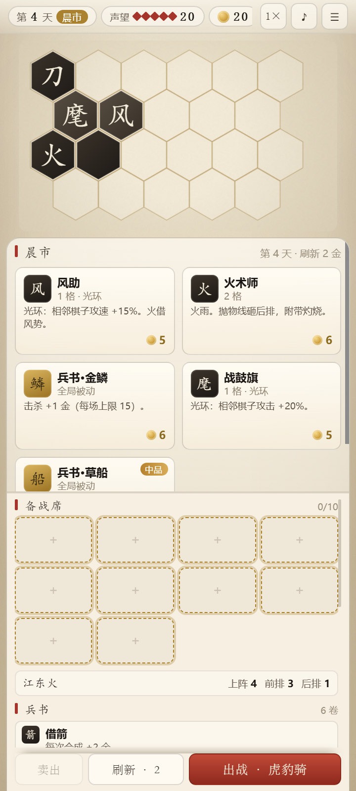
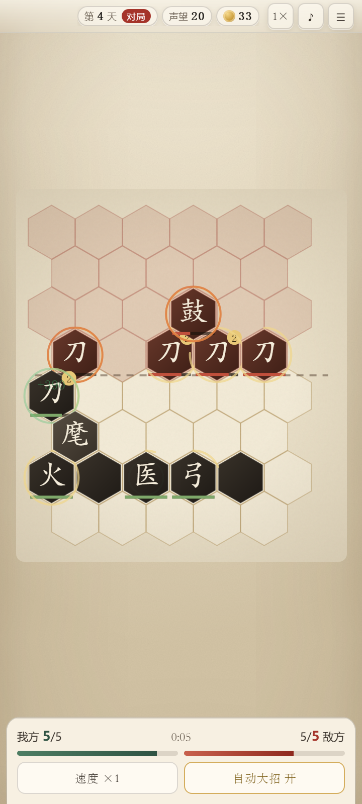
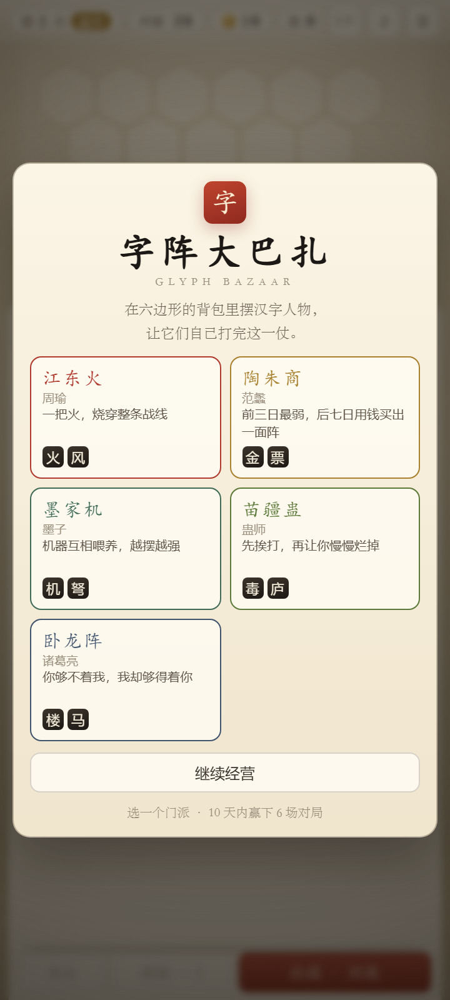

# 符阵 · Glyph Clash

> 六角背包自走棋：把「字」摆进格子，让它们自己打完这一仗。

> 在六边形的背包里摆汉字人物，前排扛伤、后排输出，让它们自己打完这一仗。

**六边形静态自走棋**。棋子不会移动，双方阵型贴着一条前线；站位决定谁先挨打，射程和抛物线决定谁打得到谁。

三块来源拼在一起：

- **《大巴扎》The Bazaar**：背包（棋子占格、有大小）、集市与刷新、兵书（全局被动）、附魔、声望、「第几天输就扣几点」
- **自走棋**：棋子即人物，有血量 / 攻击 / 出手间隔 / 射程，站位决定吃伤害的顺序
- **汉字合成**：两个**同字同级**的棋子叠在一起升一级；数据里还留了「集齐两个字觉醒名将」的整条线，**但当前版本接不通**（见 [已知断点](#已知断点实现与设计不一致)）

> 本文描述的是**代码当前实际实现**。数值出处：`js/data.js`、`js/run.js`、`js/shop.js`、`js/battle.js`、`js/ai.js`。
> 设计意图和取舍见 [DESIGN.md](DESIGN.md)（那份文档只讲「为什么」，数值以本文为准）。

## 长这样

| 晨市 · 摆阵 | 对局 | 门派 |
|---|---|---|
|  |  |  |

## 跑起来

```bash
npm install
npm run dev      # http://localhost:5173 （vite server.host: true，同局域网手机可直连）
npm run build    # 产物在 dist/，base 是相对路径，丢到任何静态服务器都能跑
npm run preview  # 预览构建产物 http://localhost:4173
```

技术栈：**Vue 3 + Vite 5**。界面是 Vue 组件，规则 / 战斗 / 绘制仍在 `js/` 下的老模块里，两者只走一个桥（见「代码怎么分层」）。
移动端优先：CSS 断点 **900px**，窄屏下面板改成底部 70dvh 的抽屉。

---

## 一局（单局）的形状

从「选门派」到「登顶 / 出局」是一局，最多 **10 天**，每天一场：

```
晨市（买棋子 / 刷货架 / 合成 / 扩建格子 / 布阵 / 附魔）
  ↓  点「出战 · <对手名>」
对局（实时演算，最长 55 秒）
  ↓  结算弹窗
下一天（对手更强，收入到账）
```

| 规则 | 数值 | 出处 |
|---|---|---|
| 开局声望 | 20 | `CFG.prestigeMax` |
| 胜利条件 | 10 天内赢满 **6 场** | `CFG.winsToFinish` |
| 失败代价 | 声望 **−（今天是第几天）**：第 3 天输 −3，第 8 天输 −8 | `Run.endBattle` |
| 出局 | 声望 ≤ 0，**或**第 10 天打完仍未满 6 胜 | `Run.endBattle` |

越晚输越疼，所以前几天可以赌，后几天每一步都肉疼。一天只有一场，**不能重打**。

---

## 经济

| 项 | 值 | 说明 |
|---|---|---|
| 起始金币 | **15** | `CFG.startGold` |
| 每日收入 | **7 + 加成 + 利息** | 第 1 天没有，第 2 天起每天晨市到账 |
| 利息 | `floor(金币 / 10)`，上限 **3**（陶朱商上限 6） | 在当天战后、次日收入前结算 |
| 战后收入加成 | 屯田 +5、陶朱商 +3 | 战后加一次，**次日收入里又会再加一次**（实现如此，见已知断点） |
| 对局胜利 | **+4 + floor(天数 / 2)** 金 | 第 1 天 +4；第 2–3 天 +5；第 4–5 天 +6；第 6–7 天 +7；第 8–9 天 +8；第 10 天 +9 |
| 刷新货架 | 2 金 | 无限次，当日常规操作 |
| 扩建一格 | 4 / 7 / 12 / 20 / 32，共 5 次，**合计 75 金** | 从 4 格铺到 9 格 |
| 卖出 | `floor((买入价 × 1.85^(等级−1) + 附魔价 × 0.5) × 50%)`，最低 1 | 温酒兵书改为 100% |
| 棋子售价 | 3–9 金（阵旗统一 5） | 见棋子表 |
| 兵书售价 | 4–10 金 | 见兵书表 |
| 附魔售价 | 4–6 金 | 见附表 |

对局中棋子身上带起来的金币（金库、票号、开市、点石成金、金鳞）在战斗结束时一次性入袋（`battle.stats.gold`）。

---

## 集市

每个货位独立掷一次：

| 结果 | 概率 | 说明 |
|---|---|---|
| 棋子 | **55%** | 没货时回落到兵书 |
| 兵书 | **28%** | 全部兵书都买过时回落到棋子 |
| 附魔 | **17%** | 只出当天品阶以内的 |

棋子货位再掷一次：

- **45% 从你已有的棋子里挑**（`owned`，排除将台；**同一枚棋子你有几个，它的权重就有几份**）——不然 20 种棋子永远合不出二级，这是合成系统能不能转起来的关键；
- 否则从**当日池子**里挑。池子 = `UNLOCK[1..day]` 的并集 + 门派专属棋子（品阶上限：第 1–2 天 1、第 3–5 天 2、第 6 天起 3）；
- 第 5 天起另有 12% 走「名将碎片池」，但那个池子当前恒为空（缺 `kind` 字段，见已知断点）。

**解锁表**（`UNLOCK`，按天累加）：

| 天 | 新增 |
|---|---|
| 1 | 刀客、医者、阵旗·战鼓 |
| 2 | 弓手 |
| 3 | 枪手 |
| 4 | 霜术师、阵旗·铁壁 |
| 5 | 盾卫、鼓手 |
| 6 | 骑将、阵旗·火盆 |
| 7 | 雷术师、阵旗·令疾、阵旗·冰鉴 |
| 8 | 阵旗·金鳞 |
| 9–10 | 无新增 |

货架数量 **4**，天机兵书 **+1**。刷新结果由 `seed + 天 + 当天刷新次数` 决定——同一天同一刷次的结果是**确定**的，重开页面不会变好。

---

## 棋盘与背包

**6 列 × 8 行 = 44 格**，偶数行 6 格、奇数行 5 格（错位六边形），上下各 22 格。

```
   行 0-2   对面
   行 3     对面前排
  ── 前线（相邻）──
   行 4     我方前排
   行 5-7   我方
```

- 我方半场物理上有 22 格，但**开局只解锁 4 格**（前排中间 2×2），**上限 9 格**，其余是虚线暗格；
- 扩建只能**挨着已有格子**生长，价格按「已买次数」查表 4 / 7 / 12 / 20 / 32；
- 棋子占 **1–3 格**：2 格和 3 格各有 **6 种朝向**（绕锚点旋转），落子时自动取第一个放得下的朝向；
- 棋盘上的棋子之间可以互相拖动换位，拖回备战席就是下阵；**战斗中完全锁定**。

**备战席 4 格**（藏兵兵书 +2 = 6）。买棋子和合成都在备战席与棋盘之间搬。

---

## 棋子

20 枚人物 + 6 面共享阵旗。血量列是**出场实际值**（`hp × hpScale 1.6`），等级每 +1 全表 ×2.1。

| 棋子 | 字 | 格 | 价 | 类型 | 血(Lv1) | 攻 | 出手间隔 | 射程 | 特性 |
|---|---|---|---|---|---|---|---|---|---|
| 刀客 | 刀 | 1 | 3 | 近战 | 1440 | 170 | 4.0s | 1 | 单体，够得着最前排 |
| 枪手 | 枪 | 2 | 5 | 长兵 | 1600 | 230 | 5.0s | 2 | 穿透，同列再捅 1 格（60%） |
| 弓手 | 弓 | 2 | 5 | 抛射 | 832 | 150 | 4.5s | 4 | 越过前排打最后排 |
| 骑将 | 骑 | 3 | 7 | 重装 | 2240 | 310 | 5.5s | 1 | 横扫，左右三格（外侧衰减） |
| 将台 | 将 | 3 | 9 | 名将 | 3040 | 440 | 4.0s | 3 | 抛射 + 溅射；**当前玩家拿不到** |
| 医者 | 医 | 1 | 4 | 治疗 | 960 | — | 5.0s | 3 | 给射程内血最少的友军回 260 |
| 盾卫 | 盾 | 2 | 5 | 辅助 | 1840 | — | 6.0s | 2 | 给射程内友军套 380 护盾（每个目标不超过其上限血的 60%） |
| 鼓手 | 鼓 | 1 | 4 | 辅助 | 1024 | — | 6.0s | 2 | 射程内友军攻速 +35%，3 秒 |
| 霜术师 | 霜 | 1 | 5 | 中排 | 880 | 150 | 5.0s | 3 | 命中减速 35%，2.5 秒 |
| 雷术师 | 雷 | 2 | 6 | 中排 | 928 | 200 | 5.0s | 4 | 连锁 3 人（第 2、3 人 75% 伤害） |
| 火术师 | 火 | 2 | 6 | 抛射 | 928 | 260 | 6.0s | 4 | 溅射 + 灼烧（30% 伤害/秒，2.5 秒） |
| 金库 | 金 | 1 | 4 | 经济 | 720 | — | 8.0s | — | 每 8 秒产 2 金 |
| 票号 | 票 | 2 | 6 | 经济 | 1024 | — | 10.0s | — | 每 10 秒产 5 金 |
| 机关人 | 机 | 2 | 5 | 光环 | 无血 | — | — | — | 相邻棋子攻击 +10% |
| 连弩车 | 弩 | 2 | 6 | 抛射 | 1152 | 110 | 2.8s | 3 | 单发低、停不下来 |
| 药庐 | 庐 | 2 | 6 | 治疗 | 1152 | — | 4.0s | 3 | 出手快、单次 170 |
| 流马 | 马 | 3 | 7 | 重装 | 1920 | 200 | 4.0s | 3 | 血不薄还能隔空打 |
| 风助 | 风 | 1 | 5 | 光环 | 无血 | — | — | — | 相邻棋子攻速 +15% |
| 毒师 | 毒 | 1 | 5 | 光环 | 无血 | — | — | — | 相邻棋子攻击附带中毒（25%/秒） |
| 望楼 | 楼 | 2 | 6 | 光环 | 无血 | — | — | — | 相邻棋子射程 +1 |

**共享阵旗**（6 枚，全部 1 格、5 金，无血挂件）：

| 阵旗 | 字 | 光环 |
|---|---|---|
| 战鼓旗 | 麾 | 相邻棋子攻击 +20% |
| 令疾旗 | 令 | 相邻棋子攻速 +15% |
| 铁壁旗 | 壁 | 相邻棋子血量上限 +20% |
| 火盆旗 | 烽 | 相邻棋子攻击附带灼烧（30%/秒） |
| 冰鉴旗 | 冰 | 相邻棋子攻击附带减速 30% |
| 金鳞旗 | 鳞 | 相邻棋子击杀 +1 金 |

**挂件（role=flag）的硬规则**：没有血量、不能被选中攻击、**不算战斗单位**——光环只给相邻 6 格，场上只剩挂件直接判负，也不释放技能。
光环数值随等级线性放大：`值 × (1 + 0.4 × (等级 − 1))`（20% 的旗到 3 级是 36%）；射程、金币这类整数不缩放；墨家机再 ×1.25；同类光环可叠加。

---

## 战斗

开打前必须满足两条：我方棋盘上有棋子，且其中**至少一枚不是挂件**（只有阵旗会被按钮拦下）。

### 索敌

`range` 不是「离自己几排」，而是「**能在最前排之后再多打几排**」：

- 近战 / 长兵：先找「离自己最近的那一排」作为最前排，`range=1` 只打这一排，`range=2` 再往后一排；
- 敌人躲到最后一排也照样挨打（棋子不能移动，否则缩在后排就能白嫖）；
- 前排死光后，「最前排」自动后退一排，不会出现打不到人的空档；
- **抛射（arc）无视射程**：直接挑对面最靠后的、还活着的棋子；
- 溅射 / 穿透 / 连锁一律不碰挂件。

### 命中形状

| 形状 | 规则 | 衰减 |
|---|---|---|
| 单体 | 1 格 | — |
| 穿透 `pierce` | 同列再往后 1–2 格 | 100% / 60% / 38% |
| 溅射 `splash` | 中心 + 周围一圈，**含中心最多 3 格** | 100% / 50% / 28%（按六边形距离） |
| 连锁 `chain` | 同时打 N 人（雷术师 3 人） | 100% / 75% / 75% |

### 伤害与状态

- 伤害 = `攻击 × 倍率 × (1 − 减伤)`；先扣护盾再扣血；
- **灼烧**：`命中伤害 × 30%` 作为每秒伤害，持续 2.5 秒（取最大值，不叠加）；
- **中毒**：和灼烧共用同一个字段与结算（只有毒师光环会给 25%；附魔·毒的 25% 没接线），**不会叠层**；
- **减速**：出手间隔 ×(1 + 减速值)，35% 或 60%，2.5 秒；
- **眩晕**：完全停手（冲阵 1.2 秒）；
- **护盾**：优先于血量被扣，辅助单次套盾不超过目标 60% 上限血；
- **加速**：**恒为 +35%**（`battle.js` 里写死 `1 + 0.35`），只有持续时间不同——所以「军令如山 +100%」实际也是 +35%。

### 背水一战

一方只剩最后 1 枚能打的棋子时，攻速 +35% 到结束（`CFG.lastStandBonus`），同时响一声锣、弹一条提示。

### 结束

一方能打的棋子归零即分胜负；打满 **55 秒**（`CFG.battleTime`）则比双方**剩余总血量**，再相同则比累计输出。
结算弹窗给：用时、双方存活数、残余血量、声望变化。

---

## 升级、合成、卖出

- **同棋子（同字）+ 同级**相叠 → 升 1 级，**上限 5 级**；`LVL = [–, 1, 2.1, 4.41, 9.26, 19.45]`，即血量 / 攻击 / 治疗每级 ×2.1；
- 尺寸不变（5 级刀客还是 1 格），合成是背包里唯一的「扩容」手段：两格变一格；
- **3 级起解锁大招**（按角色给，见下）；
- **将台（jiang）不允许参与合成**，也没有任何池子会刷它；
- 卖出价按 `买入价 × 1.85^(等级−1)` 折算，默认回收 50%，最低 1 金；附魔另算半价；
- 合成时若有「借箭」兵书，每次 +2 金。

---

## 技能：小技能人人有，大招 3 级起

### 小技能（`D.ULTS`，每枚棋子一个，自动释放）

实际间隔 = `cd × 0.55`，即 **6.1–8.3 秒**；受加速影响。

| 棋子 | 技能 | 效果（数据里的倍率） |
|---|---|---|
| 刀客 | 破军 | 打最近 3 人，各 260% |
| 枪手 | 贯日 | 打最近 2 人，各 320% |
| 弓手 | 落星 | 切后排 220% |
| 骑将 | 冲阵 | 打最近 3 人，各 300% + 眩晕 1.2s |
| 将台 | 龙胆 | 切后排 260% |
| 医者 | 回春 | 全队回复 45% 最大生命 |
| 盾卫 | 铁壁 | 全队获得 50% 最大生命护盾 |
| 鼓手 | 战意 | 全队攻速 +80%（实际 +35%），5 秒 |
| 霜术师 | 冰封 | 全体敌人减速 60%，2.6 秒 |
| 雷术师 | 天罚 | 打最近 4 人，各 320% |
| 火术师 | 燎原 | 切后排 200% + 灼烧 |
| 金库 | 开市 | 立刻 +12 金 |
| 票号 | 银号 | 立刻 +20 金 |
| 风助 | 风起 | 全队攻速 +40%（实际 +35%），4 秒 |
| 机关人 | 机巧 | 全队获得 30% 最大生命护盾 |
| 连弩车 | 箭雨 | 切后排 160% |
| 毒师 | 蛊毒 | 全体敌人减速 30%，4 秒 |
| 药庐 | 药王 | 全队回复 35% 最大生命 |
| 望楼 | 瞭望 | 全队攻速 +35%，6 秒 |
| 流马 | 疾驰 | 全队攻速 +45%（实际 +35%），5 秒 |

> ⚠️ 伤害类技能的**实际结算 = 攻击 × 倍率 × 0.5**（`battle.js` 的 `cast()`），详情卡仍按上面的倍率显示，所以真实伤害只有字面的一半。
> 「切后排」且没有写命中人数（`n`）的技能，实际是**打全体敌人**。
> 另外 **4 面挂件的技能永不触发**（挂件在 `tick()` 里被跳过），表里那四行只是数据，不是现役效果。

### 大招（`D.ROLE_ULT`，按角色给，3 级起）

| 角色 | 大招 | 效果 |
|---|---|---|
| 近战 | 破阵 | 打最近 3 人，各 350% |
| 重装 | 不动如山 | 全队获得 60% 最大生命护盾 |
| 中排 | 天火 | 切后排 300%（= 全体） |
| 抛射 | 星陨 | 切后排 280%（= 全体） |
| 治疗 | 起死回生 | 全队回复 60% 最大生命 |
| 辅助 | 军令如山 | 全队攻速 +100%（实际 +35%），6 秒 |
| 经济 | 点石成金 | 立刻 +25 金 |

充能约 **12–15 秒**（`ROLE_ULT.cd`），**挨打也会充能**：每受到 1 点伤害推进 0.04% 进度。

### 自动还是手动

对局面板有 `自动大招 开 / 关`：

- **开（默认）**：一充满就自己打出去；
- **关**：亮起的棋子出现在大招条里，点一下放。

加粗提醒：这个开关是**战斗级**的，关掉之后**敌方的大招也一起停了**（敌方不会手动点），所以「关自动大招」目前等于单方面废掉对手大招。

---

## 兵书（16 卷）与附魔（6 种）

兵书是**全局被动、不占格、可以叠多卷**；附魔贴在**单枚棋子**上（一枚只能有一个）。合成时只有**目标**那枚的附魔保留，素材上的附魔直接消失、不退钱。

| 兵书 | 价 | 真实效果 |
|---|---|---|
| 屯田 | 6 | 每场结束 +5 金（次日收入再加一次） |
| 借箭 | 5 | 每次合成 +2 金 |
| 温酒 | 5 | 卖出返还 100% |
| 藏兵 | 4 | 备战席 +2（4 → 6） |
| 天机 | 7 | 集市 +1 货位（4 → 5） |
| 草船 | 7 | 刷新时若没有棋子货位，把最后一个换成棋子 |
| 铁壁 | 10 | 全军血量上限 +12% |
| 金鳞 | 6 | 击杀 +1 金，单场上限 15 |
| 疾风 | 8 | 全军攻速 +10% |
| 长驱 | 9 | 全军攻击 +15% |
| 空城 | 9 | 我方前排（第 4 行）受伤 −25% |
| 连弩 | 7 | 抛物线棋子攻速 +25% |
| 铁骑 | 7 | **重装棋子**血量 +20%（按角色判定，不是按站位） |
| 妙手 | 7 | 普攻治疗 +50%（**不放大招治疗**） |
| 势如破竹 | 8 | 每个 5 级棋子全军攻击 +6% —— **当前无效果**（字段没接线） |
| 兵贵神速 | 6 | 开局 15 秒攻速 +40% —— **当前无效果**（字段没接线） |

| 附魔 | 价 | 效果 |
|---|---|---|
| 焰 | 5 | 攻击附带灼烧（30% 伤害/秒） |
| 霜 | 5 | 攻击附带减速 35% |
| 毒 | 6 | 攻击附带「中毒」 —— **当前无效果**（`ench.poison` 没被 `hit()` 读取） |
| 雷 | 6 | 命中时 30% 概率连锁旁边一人（50% 伤害） |
| 金 | 4 | 击杀 +1 金 —— **当前无效果**（`ench.killGold` 没被读取） |
| 护 | 4 | 该棋子受伤 −30% |

---

## 门派（5 选 1）

每个门派：一句承诺、两枚专属棋子、一套被动、开局**直接给 3 枚棋子**。

| 门派 | 主将 | 承诺（标题页） | 专属 | 被动（代码实际效果） | 开局三枚 |
|---|---|---|---|---|---|
| 江东火 | 周瑜 | 一把火，烧穿整条战线 | 火术师、风助 | 所有棋子攻击附带 **30% 灼烧**（文案写的「灼烧伤害 +40%」未实现） | 刀客、火术师、战鼓旗 |
| 陶朱商 | 范蠡 | 前三日最弱，后七日用钱买出一面阵 | 金库、票号 | 每场 +3 金（战后 + 次日各一次）+ **利息上限 6** | 刀客、金库、医者 |
| 墨家机 | 墨子 | 机器互相喂养，越摆越强 | 机关人、连弩车 | 所有**光环数值 ×1.25** | 刀客、机关人、弓手 |
| 苗疆蛊 | 蛊师 | 先挨打，再让你慢慢烂掉 | 毒师、药庐 | 所有棋子攻击附带 **20% 灼烧**（文案写「中毒叠 3 层」，中毒字段不叠层） | 刀客、毒师、医者 |
| 卧龙阵 | 诸葛亮 | 你够不着我，我却够得着你 | 望楼、流马 | 抛物线棋子 `range +1`——**对 arc 索敌无实际作用**（arc 本就无距离限制） | 刀客、望楼、弓手 |

---

## 对手

异步幽灵阵：**12 套模板**，按「从第几天开始出场」抽签，再按当天给预算和等级。

| 模板 | 出场天 | 流派 |
|---|---|---|
| 无名阵 | 1 | 教学（只有刀客） |
| 虎豹骑 | 2 | 近战 |
| 连弩营 | 2 | 远程 |
| 长枪阵 | 3 | 反击 |
| 药王谷 | 3 | 龟壳 |
| 火神庙 | 4 | 法术 |
| 三连射 | 4 | 远程 |
| 五虎将 | 5 | 名将 |
| 铁壁营 | 5 | 龟壳 |
| 双骑冲 | 5 | 近战 |
| 雷池 | 6 | 法术 |
| 空营计 | 6 | 经济 |

- **格子预算** = `2.6 + 1.15 × 天`（第 1 天 3.75，第 10 天 14.1），最多 12 枚；
- **等级**：`clamp(1 + floor(天/3), 1, 3)`，第 2 天起再 50% 概率 +1（封顶 3）——所以第 3 天就可能遇到 3 级棋子；
- **属性加成**：攻击 +5%、攻速 +2.5%、血量 +9%，各乘（天 − 1）；
- **门派被动**照模板给：墨家光环 ×1.25、东吴灼烧 25%、苗疆灼烧 18%、卧龙 arc +1（同样无实际作用）；
- 敌方棋子没有附魔，将台会随机挂一个名将名字。

---

## 操作

| 操作 | 说明 |
|---|---|
| 点棋子 | 选中，详情浮层贴在面板上沿；点空白处收起 |
| 拖动棋子 | **唯一的移动方式**：布阵 / 换位 / 拖回备战席（棋盘上的棋子按下即开始拖，备战席要过 8px 阈值） |
| 拖到同字同级的棋子上 | 合成升级（**落点必须是棋盘上的棋子**；备战席之间只会交换位置） |
| 点晨市卡片 | 购买；附魔卡会进入「选一颗棋子」状态，再点棋子附着 |
| 点虚线空格 | 第一次显示价格，**再点一次**才付钱（防误触） |
| `卖出` / `刷新 · 2` / `出战 · <对手名>` | 面板底部操作栏 |
| 对局中 `速度 ×N` | **1× / 2× / 3×** 循环 |
| 对局中 `自动大招` | 开 / 关（关掉后点大招条手动放，同时敌方也不再放） |

**战斗中不能移动、不能合成、不能买卖。**

---

## 代码怎么分层

```
index.html               Vite 入口，只有一个 #app
src/main.js              挂样式 → 依次引入 js/*.js（副作用挂到 window.GB）→ installBridge() → 挂载 Vue
src/App.vue              布局：TopBar / 棋盘 / 右侧（晨市 + 备战席或对局面板）/ 浮层
src/store.js             reactive ui + storeBridge（sync / tick / toast / modal / drag / setEnch）
src/components/
  TopBar.vue             顶栏骨架；天数/声望/金币/胜场由 GB.UI.renderTop 按 id 写值（唯一还在写 DOM 的组件）
  BoardCanvas.vue        只挂一个 <canvas>，绘制归 js/render.js，交互归 js/ui.js
  Market.vue             晨市货架
  ShopSheet.vue          备战席 + 兵书 + 名将 + 战报 + 战况 + 底部操作
  BattlePanel.vue        对局信息：存活 / 双血条 / 计时 / 大招条 / 速度 / 自动大招
  PeekTip.vue            棋子详情浮层
  ModalHost.vue          门派选择 / 结算 / 菜单三个弹窗
  ToastHost.vue          浮动提示
  DragGhost.vue          拖动残影
js/core.js               随机数（mulberry32）、数学、DOM 小工具、存档、WebAudio 合成音效
js/data.js               全部数据：CFG / LVL / PIECES / FLAGS / ULTS / ROLE_ULT / FACTIONS / HEROES / SKILLS / ENCHANTS / UNLOCK
js/map.js                六边形棋盘：6×8、坐标、形状与朝向、解锁顺序
js/battle.js             战斗：索敌、穿透/溅射、光环刷新、双层技能、状态、55 秒判定
js/ai.js                 12 套幽灵对手模板 + 按天缩放
js/run.js                一局状态：天数、金币、声望、背包格、备战席、合成、拼字、存档
js/shop.js               集市：池子、货架、刷新、买卖、附魔、卖出价
js/render.js             Canvas 渲染（ResizeObserver + DPR≤2.5）
js/ui.js                 选中 / 拖拽 / 扩格 / 弹窗 + 旧版 DOM 面板（桥接模式下旧面板直接 return）
js/main.js               状态机、主循环、速度、结算、URL 调试参数
css/style.css            :root 变量、纸底、#overlay/#toasts 兜底
tools/shot.mjs           CDP 截图脚本（真移动端视口）
```

**桥的约定**：

- `js/` 只管规则，状态变化时调 `GB.storeBridge.sync(run, battle, selected)` 把**快照**推给 Vue；
- Vue 组件只读 `store.js` 的 `ui`，动作一律回调 `GB.*`（`GB.UI.*` / `GB.Shop.*` / `GB.Game.*`）；
- 对局期间主循环每 **0.4 秒**调一次 `GB.UI.tickBattle()` → `storeBridge.tick()`，更新战斗快照；
- `ui.rev` 每次 sync 自增，跨模块的 `computed` 必须读它——`run` 是同一个对象引用，只读 `run` 不会重新计算；
- 旧面板的 `renderShop / renderBench / renderBuild / renderDetail / renderAction`、`showTitle / showResult`
  在检测到桥时直接 return，所以同一份逻辑不会画两遍。

---

## 存档与调试

- 存档：`localStorage["glyph_clash_save_v1"]`，**只在晨市阶段**写；战斗中刷新会回到当天晨市。
- URL 调试参数（`js/main.js` 的 `boot()`）：

| 参数 | 作用 |
|---|---|
| `?faction=dongwu` | 跳过门派选择，直接开局（`dongwu` / `taozhu` / `mojia` / `miaoyu` / `wolong`） |
| `&day=5` | 自动快进到第 N 天（脚本自动买卖 + 摆阵 + 打完） |
| `&auto=battle` | 自动摆阵并直接开打 |
| `&ff=20` | 开打后先空跑 20 秒（秒） |
| `&sel=1&lv=3` | 选中棋盘上第一枚棋子，可指定等级 |

---

## 已知断点（实现与设计不一致）

这些都是**当前代码跑出来的事实**，不是设计意图。改玩法之前先看这张表，否则容易在错的前提上提建议。

| # | 现象 | 位置 | 影响 |
|---|---|---|---|
| 1 | **名将 / 拼字整条线断**：碎片定义里没有 `kind: 'shard'`，而刷池与合成判定都查 `def.kind === 'shard'` | `data.js:236` vs `shop.js:20`、`run.js:261/280` | 第 5 天起的碎片永不出现、拼字永不触发；`jiang` 又不在任何池子里、也不许合成 → **玩家永远拿不到将台**，「名将」面板恒空 |
| 2 | 自动大招开关是**战斗级**的，双方共用 `b.autoUlt` | `battle.js:359` | 关掉自动 = 敌方大招也停摆，等于单方面削弱对手 |
| 3 | 伤害类技能实际只结算 `倍率 × 0.5` | `battle.js:524` | 详情卡写的是 260%/320%，实际只打出**一半**伤害 |
| 4 | 敌方释放「切后排 / 打最近」时排序方向没按阵营折算 | `battle.js:519` | 敌方的「切后排」实际打我方**前排**，敌方「打最近」反而打我方后排 |
| 5 | 兵书「势如破竹」(`rupture`) 与「兵贵神速」(`openingRush`) 只写进 mods，战斗里从不读取 | `run.js:133`、`battle.js:284` | 两卷兵书买了没有任何效果 |
| 6 | 加速效果硬编码 +35% | `battle.js:345` | 鼓手写的 +80%、军令如山写的 +100%，一律按 +35% 结算 |
| 7 | 门派文案与实现不符：江东火「灼烧 +40%」实为附带 30% 灼烧；苗疆蛊「中毒叠 3 层」实为附带 20% 灼烧；卧龙阵「arc 射程 +1」对 arc 无作用 | `run.js:149-153` | 三个门派的实际强度和承诺不一致 |
| 8 | `ai.js` 模板引用了不存在的 `flag_armor` | `ai.js:12/16` | 药王谷、铁壁营会少摆棋子，甚至提前结束填充（填充循环靠 `guard` 兜底退出） |
| 9 | `income` 类加成结算两次（战后 + 次日收入） | `run.js:320/301` | 屯田实际每天 +10，陶朱商每天 +6 |
| 10 | `CFG.lastStandAt`、`mods.orders`、`mods.killCap`、`run.lastIncome`、`run.counters.bought` 未接线 | `data.js:19` 等 | 死配置，不影响玩法 |
| 11 | `ULTS` 里给 4 面挂件（风助/机关人/毒师/望楼）写了技能，但挂件在 `tick()` 里直接 `continue` | `data.js:162/163/165/167`、`battle.js:343` | 挂件技能永不触发 |
| 12 | 速度按钮是 1× / 2× / **3×** | `main.js:156` | 旧文档写的 1/2/4 是错的 |
| 13 | 附魔「毒」「金」的 `fx` 字段没被 `hit()` 读取（只处理了 `burn/slow/chain`，`dmgTaken` 在 `baseStats`） | `data.js:269/271` vs `battle.js:434-441` | 六种附魔里两种**买了完全没用** |

---

## 单局的现状边界（评玩法时值得先知道）

这些不是 bug，是**当前单局里根本没有的能力**——评估「还能加什么」时按这张单子来：

- **看不到对手**：晨市阶段对面只有空棋盘，敌方棋子不绘制；`出战` 按钮只显示模板名。阵型要开打才第一次看见，所以站位没法针对性调整，只能赌和记。
- **货架不能锁定**：没买的货位过夜即作废（次日 `startDay` 直接重掷）。
- **战斗里只做一件事**：点大招（还要先关掉自动）；除此之外只能切速度。
- **没有战后复盘**：`battle.stats` 里算了双方总伤害和击杀数，但没有任何界面展示；结算只给用时、存活、残余血量。
- **没有分步教学**：菜单里那几段文字是唯一说明。
- **不能重打、不能改门派、不能悔棋**：一天一场，卖出是唯一的「撤销」。

---

## 调数值

数值集中在 `js/data.js`，改完刷新页面即可（dev 有热更新）：

| 想调什么 | 去哪 |
|---|---|
| 全局节奏 | `CFG`（`hpScale`、`battleTime`、`startGold`、`incomeBase`、`cellsStart/cellsMax`、`expandPrices`、`splashMul`、`pierceMul`、`lastStandBonus`） |
| 棋子本体 | `PIECES`（`hp/dmg/atk/range/pierce/splash/chain/arc/aura/price/tier/size`） |
| 成长曲线 | `LVL`（1/2.1/4.41/9.26/19.45） |
| 技能 | `ULTS`（小技能）、`ROLE_ULT`（大招） |
| 阵旗 / 兵书 / 附魔 / 门派 | `FLAGS`、`SKILLS`、`ENCHANTS`、`FACTIONS` |
| 每天刷什么 | `UNLOCK`、`poolFor()` |
| 经济与流程 | `js/run.js`（收入、利息、胜利奖金、扣声望、扩建价） |
| 战斗规则 | `js/battle.js`（索敌、衰减、充能、光环） |
| 对手强度 | `js/ai.js`（模板、预算、等级、按天加成） |
